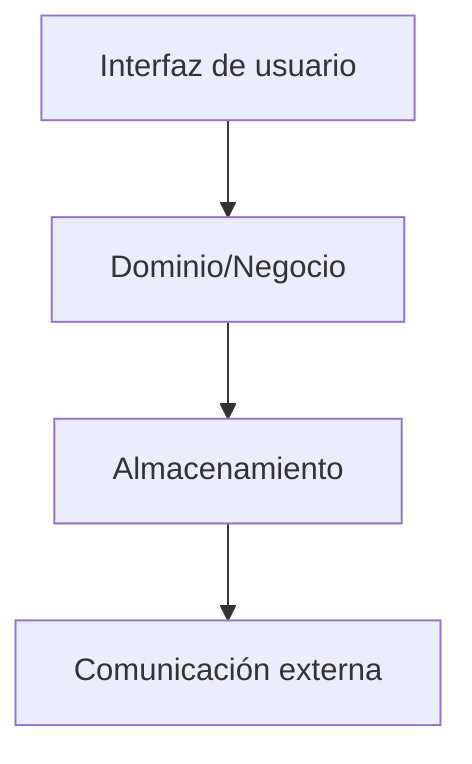

# Clasificador de animales
## Aplicación de escritorio para identificar animales
### Descripción
En el presente repositorio se muestra el código fuente con el que fue creado la aplicación de escritorio, ésta fue hecha con Flutter y con el lenguaje de programación Dart.

Con el fin de identificar a los animales correctamente se entrenó un modelo de CNN con pytorch y un aproximado de 20k de imágenes, dichas imágenes se encuentran en: [Zenodo](https://doi.org/10.5281/zenodo.19926200),  adémas, los animales que se pueden identificar con dicha aplicación son los siguientes:

Orden Strigiformes

*  Aegolius acadicus
*  Asio flammeus
*  Asio otus
*  Asio stygius
*  Athene cunicularia
*  Bubo virginianus
*  Glaucidium gnoma
*  Megascops kennicottii
*  Megascops trichopsis
*  Micrathene whitneyi
*  Psiloscops flammeolus
*  Strix virgata 
*  Strix occidentalis
*  Strix sartorii
*  Tyto furcata
 
Género Crotalus

*  Crotalus aquilus
*  Crotalus atrox
*  Crotalus basiliscus
*  Crotalus lepidus
*  Crotalus molossus
*  Crotalus polystictus
*  Crotalus pricei
*  Crotalus scutulatus
*  Crotalus willardi

Todos estos animales habitan en el estado de Zacatecas, México.

Por otro lado, el modelo puro entrenado se puede descargar en: [Modelo ResNet50](https://drive.google.com/drive/folders/1EVbwNs3NiT5-lU0dxr1VLg_0NcgxXaHS?usp=drive_link), para visualizar los resultados obtenidos por el modelo [vaya a la sección "Resultados del modelo de IA"](#resultados-del-modelo-de-ia)

---

### Diseño de la aplicación

La arquitectura de la aplicación está basada en capas, contando con 4 capas los cuales son las siguientes:

 1. La capa de UI es donde se encuentran los diseños para facilitar el trabajo de los usuarios, siendo intuitivo su uso.
 2. La capa de Dominio/Negocio contiene el backend necesario con el cual funciona la aplicación
 3. La capa de Almacenamiento contiene pequeños archivos y el modelo JSON con el cual se clasifica las imágenes.
 4. La capa de Comunicación externa es la conexión entre las imagenes y observaciones que haga el usuario con la base de datos externa de FireBase de Google.

<b>Click para ver los Mockups de la aplicación</b>

 

 
 

***

<b>Click para ver la aplicación en funcionamiento</b>

 

 
 

***

### Resultados del modelo de IA

 
Hiperparametros utilizados en tres modelos.

| Modelo | Optimizer | Epochs | Batch size | num workers | Learning rate | 
|--------|-----------|--------|------------|-------------|---------------|
| ResNet-50         | Adam | 20 | 32  | 2 | 0.001 |
| Efficient Net-B0  | Adam | 20 | 512 | 2 | 0.005 |
| Squezze Net-1.0   | Adam | 15 | 32  | 2 | 0.001 |

***

Resultados obtenidos entre el dataset de entrenamiento y el dataset de validación.

| Modelo | Pérdida (Train) | Exactitud (Train) | Pérdida (Val) | Exactitud (Val) | Tiempo promedio por época (Min). |
|--------|-----------------|-------------------|---------------|-----------------|----------------------------------|
| ResNet-50        | 0.3378 | 88.73% | 0.3412 | 88.88% | 5.45 |
| Efficient Net-B0 | 0.3893 | 87.71% | 0.38   | 87.04% | 5.06 |
| Squeeze Net-1.0  | 0.4065 | 86.61% | 0.429  | 86.71% | 5.29 |

***

Enseguida se muestra los resultados y la evolución durante la aplicación de una validación cruzada con diez folds.

 

***

Finalmente se calculó las Macro´s necesarias con el que se definió que el mejor modelo entre los tres fue ResNet-50.

| Métrica | ResNet-50 | Efficient Net-B0 | SqueezeNet-1.0 |
|---------|-----------|------------------|----------------|
| Macro puntuación F1 | 91.15% | 87.35% | 85.92% |
| Macro precisión     | 91.19% | 87.39% | 85.98% |
| Macro Sensibilidad  | 91.13% | 87.34% | 85.88% |

